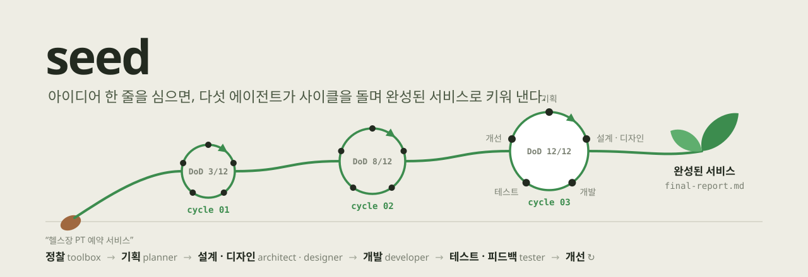

<p align="center">
  
</p>

AI에게 서비스를 맡기면 결국 사람이 계속 붙어 있어야 합니다. 스택은 뭘로 할지, DB는 어떻게 할지, 이 화면은 이게 맞는지, 테스트가 깨졌는데 어떻게 할지를 매번 묻고, 답할 때까지 멈춰 있습니다. seed는 그 질문을 사용자에게 돌려보내지 않습니다. 아이디어 한 줄만 심으면 기획자 · 설계자 · 디자이너 · 개발자 · 테스터 에이전트가 **기획 → 설계 → 개발 → 테스트 → 피드백 → 개선** 사이클을 스스로 반복해, 직접 실행하고 검증한 하나의 완성된 서비스로 키워 냅니다.

범위, 기술 스택, DB, 디자인, 우선순위, 완성 여부까지 모두 에이전트가 정합니다. 정한 것은 이유와 함께 기록으로 남기고, 실행해 보지 않은 것은 됐다고 쓰지 않습니다.

## 설치

```
/plugin marketplace add LimjeongSik/seed
/plugin install seed@seed
```

설치한 뒤 Claude Code를 재시작하거나 `/reload-plugins`를 실행하면 `/seed:plant`를 쓸 수 있습니다.

## 쓰는 법

서비스를 만들 빈 폴더에서 실행합니다. 중간에 권한 확인 창이 뜨면 사이클이 멈추므로, 권한 확인 없이 여는 것을 권장합니다.

```bash
mkdir pt-booking && cd pt-booking
claude --permission-mode bypassPermissions
```

```
/seed:plant 동네 헬스장 PT 예약 서비스
```

이것으로 끝입니다. 슬래시 명령 대신 "헬스장 PT 예약 서비스 하나 알아서 끝까지 만들어줘"처럼 말해도 seed가 시작합니다. 기존 코드의 버그 수정이나 기능 하나 추가 같은 작은 요청에는 끼어들지 않습니다.

| 명령 | 하는 일 |
|---|---|
| `/seed:plant <서비스> [--max-cycles N]` | 씨앗을 심고 완성까지 사이클을 돌림 (기본 최대 10사이클) |
| `/seed:status` | 지금 몇 번째 사이클 · 어느 단계인지, 백로그와 완성 기준 진행률, 최근 테스트 판정 |
| `/seed:stop` | 멈춤. 도는 중이면 `Esc`로 끊은 뒤 입력 |
| `/seed:resume` | 멈춘 단계부터 이어서 진행 |

"어디까지 됐어?", "멈춰", "이어서 해줘"처럼 말해도 같은 명령이 실행됩니다. 이미 있는 코드 위에서 시작하면 그 코드를 기반으로 쌓아 올립니다.

## 결과물

서비스 코드는 프로젝트 루트에, 진행 기록과 역할별 문서는 `.seed/`에 남습니다. 사이클마다 로컬 git 커밋이 하나씩 쌓이고, push는 하지 않습니다.

```
<프로젝트>/
├── (서비스 코드 · 테스트 · README)
└── .seed/
    ├── request.md        처음 받은 한 줄 요청
    ├── state.json        지금 사이클 · 단계
    ├── log.md            단계별 진행 기록
    ├── decisions.md      모든 결정과 이유, 대안, 바꾸는 법
    ├── handoff.md        실제 서비스로 바꿀 때 할 일 (외부 키, 어댑터)
    ├── toolbox.md        설치된 다른 플러그인 활용 계획
    ├── product/          prd.md · done.md (완성 기준) · backlog.md
    ├── architecture/     architecture.md
    ├── design/           design-system.md · screens.md
    ├── cycles/NN/        plan.md · build.md · report.md · shots/
    └── final-report.md   완성 보고
```

| 파일 | 담는 내용 | 쓰는 쪽 |
|---|---|---|
| `product/done.md` | 완성 기준 `DoD-NN`. 테스터가 직접 실행해서 확인할 수 있는 문장으로만 씀 | 기획자 |
| `cycles/NN/plan.md` | 이번 사이클 목표, 백로그 항목, 수용 기준 `AC-NN-x`, 설계 · 디자인 필요 여부 | 기획자 |
| `cycles/NN/report.md` | 실행 결과, AC · DoD 표, 이슈(P0~P3, 재현 절차 포함), 개선 제안, 완성 판정 | 테스터 |
| `decisions.md` | `D-NNN` 결정 기록. 무엇을, 왜, 어떤 대안을 두고 골랐는지 | 모두 |
| `final-report.md` | 실행 방법, 구현 기능, DoD 결과, 사이클 이력, 주요 결정, 남은 백로그 | 오케스트레이터 |

## 사이클

메인 대화는 감독(오케스트레이터)입니다. 직접 기획하거나 코드를 쓰지 않고, 다섯 역할 에이전트에게 일을 맡기고 결과를 보고 다음 수를 정합니다.

| 단계 | 맡는 에이전트 | 하는 일 |
|---|---|---|
| 정찰 | 도구 정찰 | 설치된 다른 플러그인을 조사해 단계별로 배치 (처음 한 번) |
| plan | [planner](agents/planner.md) 기획자 | 첫 사이클은 PRD · 완성 기준 · 백로그. 이후는 테스트 보고를 백로그로 옮기고 이번 범위를 정함 |
| design | [architect](agents/architect.md) 설계자 · [designer](agents/designer.md) 디자이너 | 스택 · DB · API · 실행 명령 / 디자인 시스템 · 토큰 · 화면 명세. 필요한 쪽만, 둘 다면 동시에 |
| build | [developer](agents/developer.md) 개발자 | 구현과 단위 · 통합 테스트. 빌드 · 테스트 통과를 실제로 돌려 확인 |
| verify | [tester](agents/tester.md) 테스터 | README대로 처음부터 실행, e2e · 회귀 · 탐색 테스트, 기본 보안 점검, 완성 판정 |
| improve | 개발자 ↔ 테스터 | 열린 P0 · P1을 고치고 다시 검증 (최대 2번 주고받음) |
| gate | 개발자 | 커밋 전에 설치된 리뷰 · 감사 도구로 게이트 통과 |
| close | 오케스트레이터 | 기록하고 커밋. 완성 판단 |

```
정찰 → plan → design → build → verify → improve → gate → close ─┐
         ▲                                                       │
         └───────────────────── 다음 사이클 ◀─────────────────────┘
```

<details>
<summary>언제 끝나나요</summary>

목표가 계속 움직여 끝나지 않는 일을 막기 위해, 완성 기준(DoD)은 첫 사이클에 정하고 이후에는 꼭 필요한 것만 이유와 함께 추가합니다. 지우지는 않습니다.

| 조건 | 결과 |
|---|---|
| 테스터 판정 "가능" (DoD 전부 통과 · 열린 P0/P1 없음 · 회귀 e2e 통과) | 기획자가 완성 검토. 승인하면 마무리, 아니면 빠진 것을 다음 사이클 범위로 |
| 판정 "불가" | 다음 사이클. 남은 이슈는 백로그 최우선으로 |
| 최대 사이클 도달 | 미완 항목을 보고서에 밝히고 마무리 |
| 같은 이슈가 세 사이클 연속 해결되지 않음 | 기획자가 접근을 바꾸거나 범위를 줄이고 기록 |

</details>

## 에이전트와 고용

다섯 에이전트는 각자 맡은 파일만 쓰고, 서로 대화가 아니라 `.seed/`의 문서로 주고받습니다. 그래서 컨텍스트가 압축되거나 세션이 바뀌어도 이어서 진행할 수 있습니다.

필요하다고 판단하면 각 에이전트가 하위 에이전트를 고용합니다. 개발자가 데이터 계층 · API · 화면을 하위 개발자 셋에게 파일 범위를 나눠 맡기거나, 기획자가 도메인 조사를 따로 맡기는 식입니다. 한 번에 최대 4명이고, 결과를 검토해 통합하는 것은 고용한 쪽의 책임입니다. 기본 깊이 제한은 메인 대화 아래 3단입니다(`CLAUDE_CODE_MAX_SUBAGENT_SPAWN_DEPTH`).

## 설치된 플러그인 활용

seed는 혼자 다 만들려 하지 않습니다. 시작할 때 이 세션에서 켜져 있는 다른 플러그인의 스킬 · 에이전트 · 훅을 조사해 `toolbox.md`로 정리하고, 각 역할이 자기 단계에서 맞는 도구를 먼저 씁니다.

| 정리하는 것 | 내용 |
|---|---|
| 단계별 활용 | 도구를 사이클 단계 · 역할에 배치 |
| 게이트 | 다른 플러그인 훅이 막는 동작과 정식으로 통과하는 방법 |
| close 실행 목록 | 매 사이클 커밋 직전에 실행할 리뷰 · 감사 · 문서 유지 스킬 |
| 묻는 지점 | 사용자에게 물으라고 하는 도구와, 대신 정할 기본값 |
| 쓰지 않는 도구 | push · 배포가 핵심인 도구 등과 그 이유 |

<details>
<summary><a href="https://github.com/LimjeongSik/baton-workflow">baton</a>과 함께 쓰면</summary>

| baton 플러그인 | seed에서 쓰이는 곳 |
|---|---|
| `ui:design` | 디자이너의 디자인 시스템 · 화면, 개발자의 화면 구현 |
| `feature`의 에이전트 | 개발자의 하위 에이전트 |
| `test:write` | 개발자 · 테스터. 러너 설치 여부는 묻지 않고 정함 |
| `refactor:sweep` | 개선 단계 |
| `biome:setup` · `context:sync` | 설계 · 첫 사이클 스캐폴딩 |
| `review:codex` · `security:audit` | gate 단계. 커밋 게이트를 정식으로 통과 |
| `progress:update` | close 실행 목록 |
| `git:ship` | push까지 하므로 그대로는 쓰지 않음 |

</details>

다른 플러그인의 게이트는 그 플러그인이 정한 방법으로만 통과합니다. 게이트를 끄는 환경 변수, `--no-verify`, 훅 우회는 쓰지 않습니다. 게이트가 사용자 확인을 띄울 상황(예: 전제 CLI 미설치)이면 그 사이클의 커밋을 건너뛰고 이유를 기록합니다. 다른 플러그인이 넣어 주는 사용자 선호와 규칙은 따르되, "사용자에게 묻지 않는다"는 원칙만은 seed가 우선합니다.

활용하려면 그 플러그인이 대상 프로젝트에서 켜져 있어야 합니다(user 범위로 설치하거나 그 프로젝트에 설치). 실행 중에 플러그인을 새로 설치했으면 `/seed:resume` 때 다시 조사합니다.

## 멈추지 않게 하는 장치

| 장치 | 하는 일 |
|---|---|
| Stop 훅 | 완성 전에는 턴 종료를 막고 다음 단계로 보냄. 에이전트 결과를 기다리는 중이면 막지 않고, 상태 변화 없이 3번 연속 막히면 `stalled`로 표시하고 놓아줌 |
| 질문 차단 | 실행 중 `AskUserQuestion`을 막고, 직접 정해서 `decisions.md`에 기록하게 함 |
| 압축 후 이어가기 | 컨텍스트가 압축되면 상태 파일을 다시 읽고 현재 단계부터 이어감 |
| 실행 주인 | 실행을 시작한 세션에만 위 장치가 걸림. 같은 폴더의 다른 세션은 방해받지 않음 |

## 원칙

모든 에이전트가 지키는 원칙입니다. 자세한 내용은 [shared/autonomy.md](shared/autonomy.md)에 있습니다.

- **묻지 않고 정합니다.** 모호하면 이미 정한 것과 맞는 쪽 → 표준적인 쪽 → 되돌리기 쉬운 쪽 → 단순한 쪽으로 정하고, 이유와 바꾸는 법을 함께 남깁니다.
- **키 없이 끝까지 돌아가야 완성입니다.** 가입이나 API 키가 필요한 기능은 로컬 대체 구현(SQLite, 자체 인증, 콘솔 메일 등)을 어댑터 뒤에 두고, 실제 서비스로 바꾸는 법은 `handoff.md`에 적습니다.
- **실행해 본 것만 됐다고 씁니다.** 테스터는 개발자의 보고를 믿지 않고 README대로 처음부터 돌려 봅니다.
- **막혀도 멈추지 않습니다.** 같은 방법이 두 번 실패하면 다른 방법으로, 세 번째에는 범위를 줄이거나 우회하고 기록합니다.
- **프로젝트 밖은 건드리지 않습니다.** push, 배포, 결제, 실제 발송, 전역 설치를 하지 않고 비밀값을 남기지 않습니다.
- **한국어로 씁니다.** 문서 · 보고 · 커밋 메시지는 한국어로 쓰고, 실행을 시작하면 그 프로젝트의 `.claude/settings.json`에 `"language": "korean"`을 넣습니다.

## 필요한 것

- Claude Code
- 서비스가 쓸 런타임. 설치된 것을 보고 스택을 고르므로, 웹 서비스라면 Node.js가 있으면 됩니다.
- git. 없으면 사이클별 커밋 없이 진행합니다.
- e2e 테스트용 브라우저. 설계자가 Playwright를 고르면 프로젝트 안에 설치합니다.

## 개발

```
.claude-plugin/        plugin.json · marketplace.json
commands/              plant · resume · status · stop
skills/cycle/          오케스트레이터 플레이북
agents/                planner · architect · designer · developer · tester
shared/                autonomy.md · workspace.md (실행 시 .seed/rules/로 복사) · toolbox-guide.md
hooks/hooks.json       Stop · PreToolUse · SessionStart · UserPromptSubmit
scripts/               훅 스크립트 (bash, 외부 의존 없음)
assets/banner.svg
```

저장소를 받아 고친 뒤에는 `--plugin-dir`로 빈 폴더에서 써 봅니다. 설치한 seed와 함께 쓰면 같은 플러그인이 두 번 잡히니, 먼저 `/plugin`에서 설치한 쪽을 꺼 두세요.

```bash
git clone https://github.com/LimjeongSik/seed.git
mkdir playground && cd playground
claude --plugin-dir <seed를 받은 경로> --permission-mode bypassPermissions
```

## 앞으로

- [ ] 사이클별 토큰 · 시간 사용량 기록
- [ ] 모바일 앱(React Native · Expo) 기본 스택과 시뮬레이터 검증
- [ ] 완성 후 배포 준비 단계 (사용자 승인 하에)

## 라이선스

MIT
